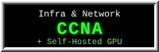
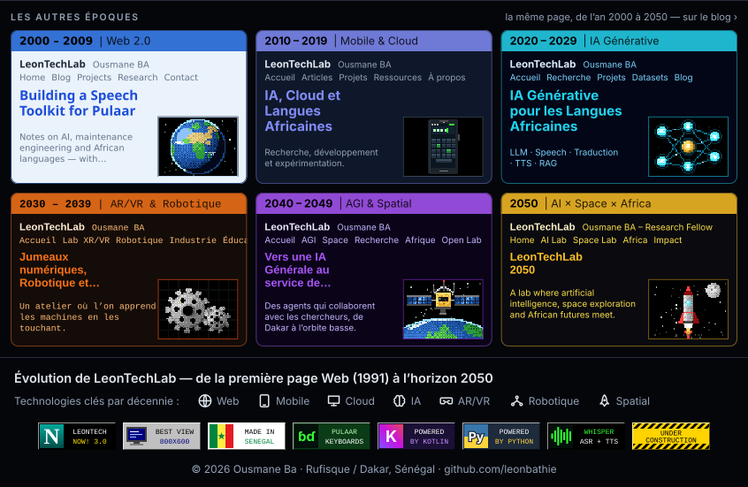

<!--
  Page générée par scripts/build.mjs — ne pas la modifier à la main :
  changer scripts/content.mjs, puis lancer « node scripts/build.mjs ».
-->

<a href="https://blog.173-249-2-195.sslip.io/?forme=evolution#/" title="LeonTechLab — the research blog of Ousmane BA"><picture><source media="(max-width: 640px)" srcset="https://raw.githubusercontent.com/leonbathie/leonbathie/main/assets/header-mobile.svg"></picture></a>

<a href="https://blog.173-249-2-195.sslip.io/?forme=evolution#/" title="Open the page in the time machine: 1991 → 2050"><picture><source media="(max-width: 640px)" srcset="https://raw.githubusercontent.com/leonbathie/leonbathie/main/assets/netscape-mobile.svg"></picture></a> 
<a href="https://blog.173-249-2-195.sslip.io/?forme=evolution#/" title="Start — open LeonTechLab"><picture><source media="(max-width: 640px)" srcset="https://raw.githubusercontent.com/leonbathie/leonbathie/main/assets/taskbar/start-mobile.svg"></picture></a><a href="https://blog.173-249-2-195.sslip.io/?forme=evolution#/recherche" title="Latest notes — the research blog"><picture><source media="(max-width: 640px)" srcset="https://raw.githubusercontent.com/leonbathie/leonbathie/main/assets/taskbar/notes-mobile.svg"></picture></a><a href="https://blog.173-249-2-195.sslip.io/?forme=evolution#/labo/glitch" title="Research lab — interactive simulators"><picture><source media="(max-width: 640px)" srcset="https://raw.githubusercontent.com/leonbathie/leonbathie/main/assets/taskbar/lab-mobile.svg"></picture></a><a href="https://blog.173-249-2-195.sslip.io/?forme=evolution#/projets" title="Projects and systems in production"><picture><source media="(max-width: 640px)" srcset="https://raw.githubusercontent.com/leonbathie/leonbathie/main/assets/taskbar/projects-mobile.svg"></picture></a><a href="https://blog.173-249-2-195.sslip.io/?forme=evolution#/parcours" title="About — career and key figures"><picture><source media="(max-width: 640px)" srcset="https://raw.githubusercontent.com/leonbathie/leonbathie/main/assets/taskbar/about-mobile.svg"></picture></a><a href="https://github.com/leonbathie?tab=repositories" title="Software — the repositories on GitHub"><picture><source media="(max-width: 640px)" srcset="https://raw.githubusercontent.com/leonbathie/leonbathie/main/assets/taskbar/software-mobile.svg"></picture></a><a href="https://linkedin.com/in/husary" title="LinkedIn"><picture><source media="(max-width: 640px)" srcset="https://raw.githubusercontent.com/leonbathie/leonbathie/main/assets/taskbar/linkedin-mobile.svg"></picture></a><a href="mailto:ousmanhabsaba@gmail.com" title="Send me an e-mail"><picture><source media="(max-width: 640px)" srcset="https://raw.githubusercontent.com/leonbathie/leonbathie/main/assets/taskbar/mail-mobile.svg"></picture></a><a href="https://play.google.com/store/apps/details?id=com.pulaar.clavier" title="Ff — the Tappirgal Pulaar keyboard on Google Play"><picture><source media="(max-width: 640px)" srcset="https://raw.githubusercontent.com/leonbathie/leonbathie/main/assets/taskbar/tray-mobile.svg"></picture></a>

<samp>
<ul>
<li><a href="https://blog.173-249-2-195.sslip.io/?forme=evolution#/recherche/asr-pul-2026">Scaling Pulaar &amp; Wolof Speech-to-Text: Fine-Tuning Whisper under Real Acoustic Constraints</a> (Oct 2026) </li>
<li><a href="https://blog.173-249-2-195.sslip.io/?forme=evolution#/recherche/sec-emfi-2026">Electromagnetic Fault Injection (EMFI) &amp; Voltage Glitching on Industrial Bootloaders</a> (Oct 2026)</li>
<li><a href="https://blog.173-249-2-195.sslip.io/?forme=evolution#/recherche/cps-gmao-2026">From Passive CMMS to Predictive Scheduling: Cutting Stoppages by 25% on a Bottling Line</a> (Aug 2026)</li>
<li><a href="https://blog.173-249-2-195.sslip.io/?forme=evolution#/recherche/nlp-claviers-2026">Phonetic Tokenization &amp; Distributed Voice Collection for Atlantic and Mande Languages</a> (Aug 2026)</li>
<li><a href="https://blog.173-249-2-195.sslip.io/?forme=evolution#/recherche/sec-mcp-fault-2026">Hybrid Offensive Security: Autonomous MCP Agents and Hardware Fault Injection (Faulty Cat)</a> (Jun 2026)</li>
<li><a href="https://blog.173-249-2-195.sslip.io/?forme=evolution#/recherche/cult-3d-veo-2026">Algorithmic Preservation of Oral Heritage: From the Fables of Bouki and Leuk to 3D Video Synthesis</a> (Mar 2026)</li>
<li><a href="https://blog.173-249-2-195.sslip.io/?forme=evolution#/recherche/ind-weibull-2025">Stochastic MTBF/MTTR Optimization with the Weibull Law &amp; CMMS Automation</a> (Dec 2025)</li>
</ul>
</samp>

<samp>
<table>
<tr><th colspan="2" align="left">African keyboards</th></tr>
<tr><td><a href="https://play.google.com/store/apps/details?id=com.pulaar.clavier"><b>Tappirgal Pulaar</b></a> Kotlin · <a href="https://play.google.com/store/apps/details?id=com.pulaar.clavier">Google Play</a></td><td>Native Android &amp; iOS keyboard for Pulaar/Fulfulde, with lexical prediction.</td></tr>
<tr><td><b>Wolof · Joola · Sooninke · Mandinka · Seereer</b> Kotlin · private</td><td>Five more keyboards built on the same modular engine, for the languages of Senegal.</td></tr>
<tr><td><a href="https://github.com/leonbathie/pcfulfulde"><b>pcfulfulde</b></a> Python · public</td><td>Fulfulde keyboard driver and utility for PC, for office work and academic editing.</td></tr>
<tr><th colspan="2" align="left">AI, Vision &amp; Web</th></tr>
<tr><td><b>Lingoo</b> JavaScript · private</td><td>Distributed platform that collects and validates multilingual voice data for ASR/TTS training.</td></tr>
<tr><td><b>Taro Learning</b> Kotlin · private</td><td>Educational mobile app: interactive learning, syllabaries and African tales.</td></tr>
<tr><td><b>DIADJI</b> Python · private</td><td>Express checkout, stock management, PDF invoicing and AI Vision scanner.</td></tr>
<tr><td><a href="https://github.com/leonbathie/flow-video-merger"><b>flow-video-merger</b></a> JavaScript · public</td><td>Chrome extension &amp; web studio that captures, sequences and merges in 4K the videos generated by Google Flow (Veo).</td></tr>
<tr><td><a href="https://github.com/leonbathie/blog"><b>blog</b></a> Vue · public</td><td>This research blog: one content, seven interchangeable forms. The latest is a Web time machine, from 1991 to 2050.</td></tr>
<tr><td><a href="https://github.com/leonbathie/SPARK-2026"><b>SPARK-2026</b></a> Jupyter · public</td><td>Scientific research notebooks, data processing and AI modeling (SPARK Academy).</td></tr>
<tr><th colspan="2" align="left">Cybersecurity</th></tr>
<tr><td><a href="https://github.com/leonbathie/jjuiceshop"><b>jjuiceshop</b></a> Security · public</td><td>Vulnerability analysis scripts, payloads and automated solving of the OWASP challenges.</td></tr>
<tr><td><a href="https://github.com/leonbathie/juice-shop"><b>juice-shop</b></a> TypeScript · public</td><td>OWASP Juice Shop environment for offensive training, web pentesting and exploit automation.</td></tr>
<tr><td><b>SecureCapture</b> Security · private</td><td>Hardened module for forensic capture and protection of sensitive data streams.</td></tr>
</table>
</samp>

<a href="https://blog.173-249-2-195.sslip.io/?forme=evolution#/"><kbd>&nbsp;Blog&nbsp;</kbd></a>
<a href="https://blog.173-249-2-195.sslip.io/?forme=evolution#/recherche"><kbd>&nbsp;Notes&nbsp;</kbd></a>
<a href="https://blog.173-249-2-195.sslip.io/?forme=evolution#/labo/glitch"><kbd>&nbsp;Lab&nbsp;</kbd></a>
<a href="https://blog.173-249-2-195.sslip.io/?forme=evolution#/projets"><kbd>&nbsp;Projects&nbsp;</kbd></a>
<a href="https://blog.173-249-2-195.sslip.io/?forme=evolution#/parcours"><kbd>&nbsp;About&nbsp;</kbd></a>
<a href="https://github.com/leonbathie?tab=repositories"><kbd>&nbsp;Software&nbsp;</kbd></a>
<a href="https://linkedin.com/in/husary"><kbd>&nbsp;LinkedIn&nbsp;</kbd></a>
<a href="mailto:ousmanhabsaba@gmail.com"><kbd>&nbsp;E-mail&nbsp;</kbd></a>

<a href="https://blog.173-249-2-195.sslip.io/?forme=evolution#/" title="The same page, from 1991 to 2050"><picture><source media="(max-width: 640px)" srcset="https://raw.githubusercontent.com/leonbathie/leonbathie/main/assets/outro-mobile.svg"></picture></a>

